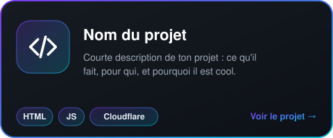

<!--
  ⚠️ AVANT DE PUSH : remplace partout
     lp-alyx  -> ton pseudo GitHub (ex: alyx)
     lp-alyx    -> le nom du repo de ton projet (pour le compteur d'étoiles)
-->

 

<!-- ───────────── STATS ───────────── -->

  

<!-- ───────────── IDENTITÉ ───────────── -->

# Alyx

**Vibe codeur** &nbsp;·&nbsp; 🇫🇷 France &nbsp;·&nbsp; 🎓 Étudiant &nbsp;·&nbsp; 🕵️ OSINT spécialist

 

<!-- ───────────── COMPÉTENCES ───────────── -->

## 🛠️ Compétences

 

 

<!-- ───────────── PROJETS ─────────────
  Pour ajouter un projet : python tools/new_card.py --help
  puis colle la ligne  qu'il affiche, à la suite de la carte ci-dessous.
-->

## 🚀 Projets

 

<!-- ───────────── CONTACT ───────────── -->

## 📬 Contact

Solana : <code>5sXWcT59x6XsG8Qzzrgit5UiRdZn5HqSt43YMXkKJr1k</code>

